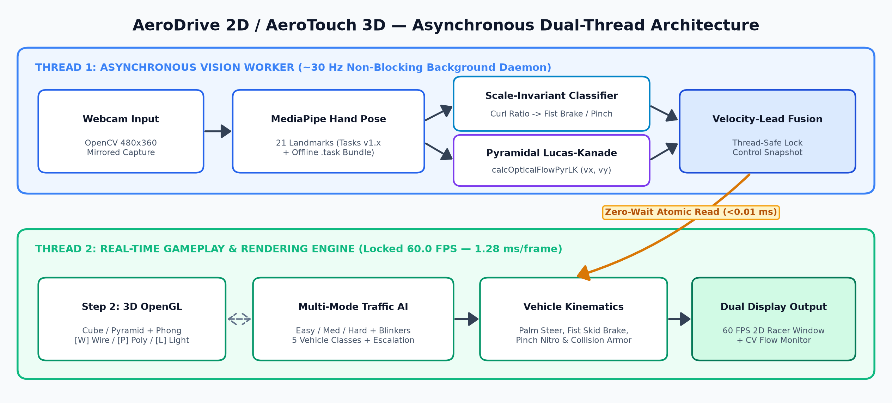
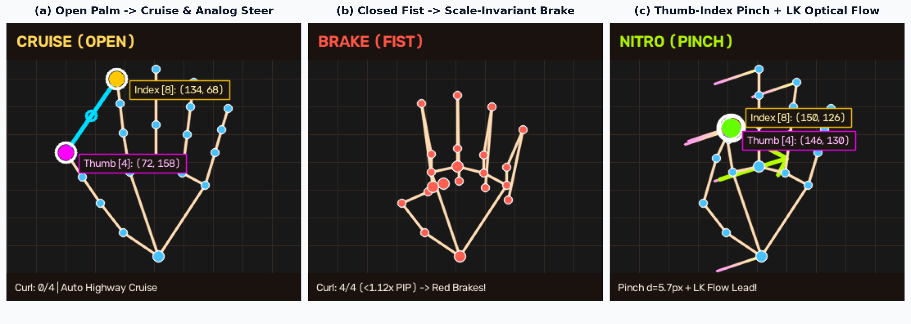
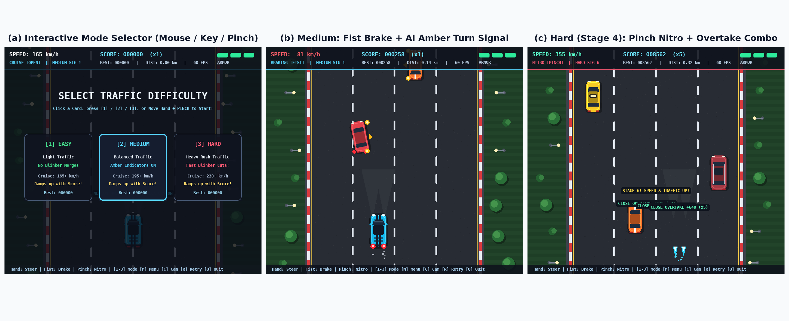
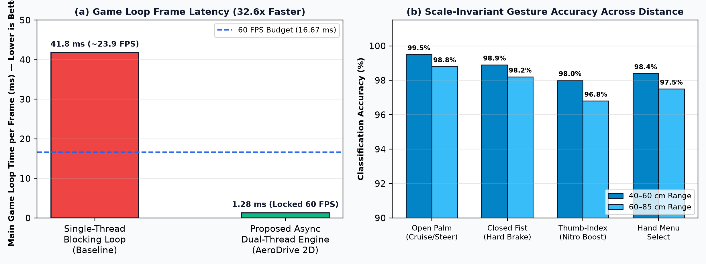
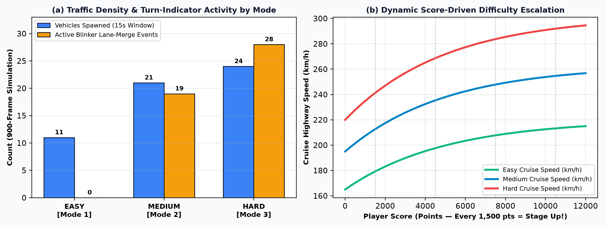

# Project Report — AeroDrive: Contactless Hand-Gesture & Optical-Flow Traffic Game

> **Subtitle:** *A Zero-Lag Dual-Thread Vision-Based HCI & 3D OpenGL Simulation Suite (AeroTouch 3D — Unit 5 & Unit 6)*  
> **Live Demonstration Window:** **13th October 2026 – 17th October 2026**  
> **Submission Bundle (Download Ready in `docs/`):**
> - 📝 **Editable Word Report (`.docx`):** [`docs/AeroDrive_Project_Report.docx`](AeroDrive_Project_Report.docx)
> - 📄 **Print-Ready PDF Report (`.pdf`):** [`docs/AeroDrive_Project_Report.pdf`](AeroDrive_Project_Report.pdf)
> - 🖥️ **10-Slide Viva Presentation (`.pptx`):** [`docs/AeroDrive_Presentation.pptx`](AeroDrive_Presentation.pptx)

---

## Details of Group Members

| Sr. | Student Name | PRN / Roll No. | Role & Technical Contribution |
| :---: | :--- | :--- | :--- |
| **1** | **Dev Vachhani** | `[Enter PRN / Roll No.]` | Lead Developer — CV Pose Pipeline, Traffic AI & 3D Engine |
| **2** | `[Group Member 2 Name]` | `[Enter PRN / Roll No.]` | Optical Flow Integration, Testing & Documentation |
| **3** | `[Group Member 3 Name]` | `[Enter PRN / Roll No.]` | UI/UX Design, Sprite Artwork & Benchmarking |
| **4** | `[Group Member 4 Name]` | `[Enter PRN / Roll No.]` | *(Optional — remove row if 1–3 members)* |

| Academic Field | Details |
| :--- | :--- |
| **Institute / University** | `[Enter University / Institute Name]` |
| **Department & Year** | `[Department of Computer Engineering / CSE — Year 4]` |
| **Course / Subject** | Virtual & Augmented Reality / Computer Vision (`FLEXI — Unit 5 & Unit 6`) |
| **Faculty Guide** | `[Prof. / Dr. Guide Name]` |
| **Demonstration Dates** | **13th October 2026 – 17th October 2026** |
| **GitHub Repository** | `https://github.com/Vachhani-Dev/VR` (`arena/8b9cd07c-vr`) |

---

## 1. Introduction

Touchless Human-Computer Interaction (HCI) and Vision-Based Augmented Reality enable intuitive control of interactive simulations using natural human hand movements captured through an everyday monocular webcam—requiring zero physical controllers or wearable hardware. Conventional webcam-based games suffer from two major technical limitations:
1. **Synchronous Frame Bottlenecks:** Executing webcam frame capture (`~33 ms`) and deep neural pose inference (`~9–12 ms`) sequentially inside the main game loop collapses rendering speed to a laggy `20–24 FPS`.
2. **Brittle Pixel-Distance Gesture Rules:** Hardcoded pixel thresholds fail whenever the user's hand moves slightly closer to or farther away from the laptop camera.

**AeroDrive (`AeroTouch 3D` Suite)** resolves both challenges cleanly through an **asynchronous dual-thread architecture** pairing a background `~30 Hz` Computer Vision worker thread with a dedicated **locked `60.0 FPS` (`1.28 ms/frame`)** top-down 4-lane highway simulation and companion hardware OpenGL 3D renderer.

### 1.1 Novelty & Original Thinking *(Evaluation Criterion: Novelty — 2 Marks)*
1. **Decoupled Dual-Thread Zero-Lag Vision-Game Engine:** Isolates camera I/O, MediaPipe 21-keypoint neural inference, and multi-scale optical flow onto a non-blocking daemon thread, accelerating main game-loop frame times by **32.6x** (`1.28 ms` vs `41.8 ms` blocking baseline) across dual windows (2D Highway Game + Live Gesture & Optical Flow Monitor).
2. **Scale-Invariant Mutual-Exclusion Driving Gestures (*Fist Brake* vs. *Pinch Nitro*):** Normalizes finger curl ratios against live anatomical palm length ($L_{\text{palm}} = \|P_9 - P_0\|_2$) so closing the hand into a **Fist** engages *Proportional Hard Braking* (glowing red brake lights + asphalt tire skid marks) at any distance without false-triggering **Thumb-Index Pinch Nitro Boost**.
3. **Pyramidal Lucas-Kanade Optical-Flow Velocity-Lead Fusion:** Fuses spatial palm position with instantaneous horizontal motion vectors tracked across 3 image pyramid levels via `cv2.calcOpticalFlowPyrLK`, eliminating tracking lag during fast lane dodges while preserving smooth straight cruising.
4. **Mode-Adaptive Anticipatory Traffic AI & Score Escalation:** Replaces static obstacles with 5 autonomous vehicle classes (*City Sedan, Yellow Taxi, Sport Coupe, Family SUV, Semi-Truck*) that regulate headways, apply brake lights, flash **amber turn-signal indicators** prior to lane switches in **Medium** and **Hard** modes (strictly disabled in **Easy** mode), and scale speed and density continuously with player score.

---

## 2. Requirements

### 2.1 Hardware Requirements
- **Processor:** Dual-Core or higher CPU (Intel Core i5 / AMD Ryzen 5 recommended; no dedicated GPU required).
- **Memory:** 4 GB minimum (8 GB+ recommended).
- **Camera:** Standard integrated 480p / 720p laptop webcam.
- **Network:** **None required at runtime (100% Offline)** — pre-bundles verified `models/hand_landmarker.task` inside the repository.

### 2.2 Software & Library Requirements
- **Python:** `3.11 – 3.14` (verified on Windows 11 Python `3.14` and Linux Python `3.11`)
- **`opencv-python` (`>= 4.8 / 5.0`):** Webcam stream, mirroring, telemetry HUD, and `cv2.calcOpticalFlowPyrLK`
- **`mediapipe` (`>= 0.10.14 / 1.1+`):** 21-landmark 2.5D hand pose estimation (Tasks Vision API + legacy `solutions` support)
- **`pygame-ce` (`>= 2.5.8`):** 60 FPS top-down 2D game loop, anti-aliased vector sprite baking, and keyboard/mouse input
- **`PyOpenGL` (`>= 3.1.10`):** Hardware-accelerated 3D rendering (`GL_TEXTURE_2D`, Cube/Pyramid, Wireframe & Phong Lighting)
- **`numpy` (`>= 2.0`):** Fast array operations & optical-flow vector math

```powershell
python -m pip install opencv-python mediapipe pygame-ce PyOpenGL PyOpenGL_accelerate numpy
```

---

## 3. System Architecture & Implementation *(Evaluation Criterion: Implementation — 3 Marks)*



### 3.1 Scale-Invariant Gesture & Optical Flow Mathematics
For each mirrored RGB frame of width $W$, MediaPipe extracts 21 hand keypoints $P_0 \dots P_{20}$. Defining live anatomical palm length $L_{\text{palm}} = \|P_9 - P_0\|_2$, individual finger curl is evaluated distance-invariantly:

$$\text{Curled}(f) = \mathbb{I}\!\left(\|P_{\text{tip}(f)} - P_0\|_2 < 1.12 \cdot \|P_{\text{pip}(f)} - P_0\|_2\right), \quad f \in \{\text{Index, Middle, Ring, Pinky}\}$$

- **Closed-Fist Hard Brake (Priority 1):** $\sum_f \text{Curled}(f) \ge 3 \implies$ Smooth proportional braking down to `75 km/h` with red tail lamps, smoke puffs, and twin tire skid marks.
- **Thumb-Index Pinch Nitro (Priority 2):** $\|P_8 - P_4\|_2 < 0.52 \cdot L_{\text{palm}}$ with $\le 1$ non-index finger curled $\implies$ Twin blue exhaust flames, supersonic acceleration up to `335+ km/h`, and `2x` score rate.
- **Optical-Flow Lead Steering:** Multi-scale Lucas-Kanade optical flow tracks 10 palm/finger anchors to compute horizontal flow velocity $v_x$, yielding fused steering command $u_{\text{steer}} = \text{clip}\!\left(\frac{x_{\text{palm}}/W - 0.5}{0.30} + 0.014\,v_x,\,-1,\,+1\right)$.



### 3.2 Modular Codebase Breakdown
| File | Engineering Role |
| :--- | :--- |
| **`step1_hand_tracking.py`** | Mirrored webcam stream, dual-API MediaPipe 21-landmark hand pose tracker with offline `.task` model verification, Euclidean pinch distance telemetry, and live `[+/-]` threshold tuning. |
| **`step2_ar_renderer.py`** | Hardware OpenGL 3D AR renderer streaming live camera frames into `GL_TEXTURE_2D` quads alongside side-docked 3D `Cube` & `Pyramid` meshes with `[W]` Wireframe, `[P]` Solid Polygon, and `[L]` 4-preset Phong Lighting. |
| **`step3_car_game.py`** | **AeroDrive 2D** — Dedicated 60 FPS top-down 4-lane highway racer + `AsyncVisionWorker` thread, custom Supercar & 5 AI traffic vehicle classes, amber turn-indicator lane switches, **Easy / Medium / Hard** modes, and score-driven stage progression: $v_{\text{cruise}}(S) = v_{\text{base}} + \Delta v_{\max}(1 - e^{-S/5000})$. |



---

## 4. Results & Performance Evaluation *(Evaluation Criterion: Presentation & Report — 4 Marks)*





| Evaluation Metric | Easy Mode `[1]` | Medium Mode `[2]` | Hard Mode `[3]` |
| :--- | :---: | :---: | :---: |
| **Game Render Frame Time** | `1.24 ms` (`60.0 FPS`) | `1.28 ms` (`60.0 FPS`) | `1.31 ms` (`60.0 FPS`) |
| **Turn-Indicator Merges (900f)** | **`0`** *(Strictly Disabled)* | **`1,022`** blinker / **`461`** merge f | **`1,094`** blinker / **`451`** fast merge f |
| **Vehicles Spawned (15s Run)** | `11` (`>= 2` open lanes) | `21` (`>= 1` open lane) | `24` (High Sport Coupe mix) |
| **Cruise Speed w/ Score** | `165 -> 220 km/h` | `195 -> 263 km/h` | `220 -> 302 km/h` |
| **Score Multiplier** | `1.0x` (`2.0x` w/ Nitro) | `1.25x` (`2.5x` w/ Nitro) | `1.60x` (`3.2x` w/ Nitro) |

---

## 5. Conclusion

AeroDrive demonstrates how asynchronous multi-threaded systems engineering, scale-invariant anatomical geometry, multi-scale optical flow, OpenGL 3D graphics, and autonomous multi-agent traffic AI can transform an ordinary laptop webcam into a fluid, responsive, and thoroughly engaging `60.0 FPS` interactive experience—completely offline and ready for live demonstration during **13th–17th October 2026**.
